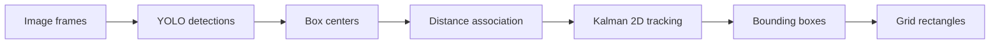

# AI-beam

Basic building blocks for a vehicle-detection course project: YOLO inference, box fusion, image-position tracking and bounding-box grid projection.

| Module | Functionality |
|---|---|
| `detector_ensemble` | YOLO wrapper, IoU, class-aware NMS and confidence-weighted box fusion |
| `sensor_fusion` | Fixed-noise Kalman filter with image state `[x, y, vx, vy]` |
| `tracking` | Greedy same-class association by pixel distance |
| `grid_geometry` | Grid rectangles, boolean masks and adjacent-region merging |
| `zone_logic` | Direct projection of bounding-box extent onto a configurable grid |

All positions and box dimensions use image pixels. The examples use generated observations and user-configurable filter settings.

## Installation

Use Python 3.10 or newer. From the repository directory:

```powershell
python -m venv .venv
.\.venv\Scripts\Activate.ps1
python -m pip install -e .
```

NumPy is the required dependency for the core algorithms and synthetic demo.

## Synthetic demo

```powershell
python examples/synthetic_demo.py
python examples/synthetic_demo.py --frames 20 --fps 30 --seed 7
```

The demo generates noisy image positions, smooths them with a Kalman filter, and prints grid rectangles for synthetic bounding boxes. It writes no files and needs no input assets.

## Core API

```python
from aura_beam import ControlTarget, KalmanFilter2D, MatrixGridController

tracker = KalmanFilter2D(dt=1 / 30)
tracker.initialize(x=320, y=180)
x, y = tracker.update(322, 181)

target = ControlTarget(x=x, y=y, box_width=80, box_height=40)
regions = MatrixGridController().get_dark_rectangles(
    targets=[target], screen_width=640, screen_height=360,
)
print(regions)
```

Set `process_variance`, `measurement_variance` and `initial_variance` when constructing `KalmanFilter2D`. These values remain fixed during filtering. `update(None, None)` performs a motion prediction when the image-position observation is unavailable.

`get_dark_rectangles()` clips each box to the image and covers the grid cells it overlaps. Bounding-box right/bottom edges are exclusive; returned grid coordinates are inclusive. `rectangles_to_mask()` converts regions into a boolean array.

For multiple targets, use `associate_detections_by_distance()` with `TrackPrediction` and `DetectionInput` objects and a maximum pixel distance. It matches each same-class track/detection pair once, greedily by distance.

## Optional YOLO inference

```powershell
python -m pip install -e ".[detector]"
```

Provide your own local weights and a NumPy image array:

```python
from aura_beam import EnsembleDetector

detector = EnsembleDetector(
    primary_model_path="weights/primary.pt",
    detector_mode="primary",
)
detections = detector.detect(frame)
```

Modes are `primary`, `secondary`, `ensemble_nms` and `ensemble_weighted`. Ensemble modes require both model paths. Results contain `box` (XYXY), `cls`, `conf` and `source`. Supply your own images/video and weights for an application.

## Putting a course project together



Create one filter per track. Use box centers for association, update each filter with its matched observation, and project a box centered on the filtered position while retaining its detected width and height. Use your own input sequence to inspect the resulting positions and regions.

## Tests

```powershell
python -m pip install -e ".[test]"
python -m pytest
```

Tests use generated arrays and stub detectors, without downloaded models or hardware.
